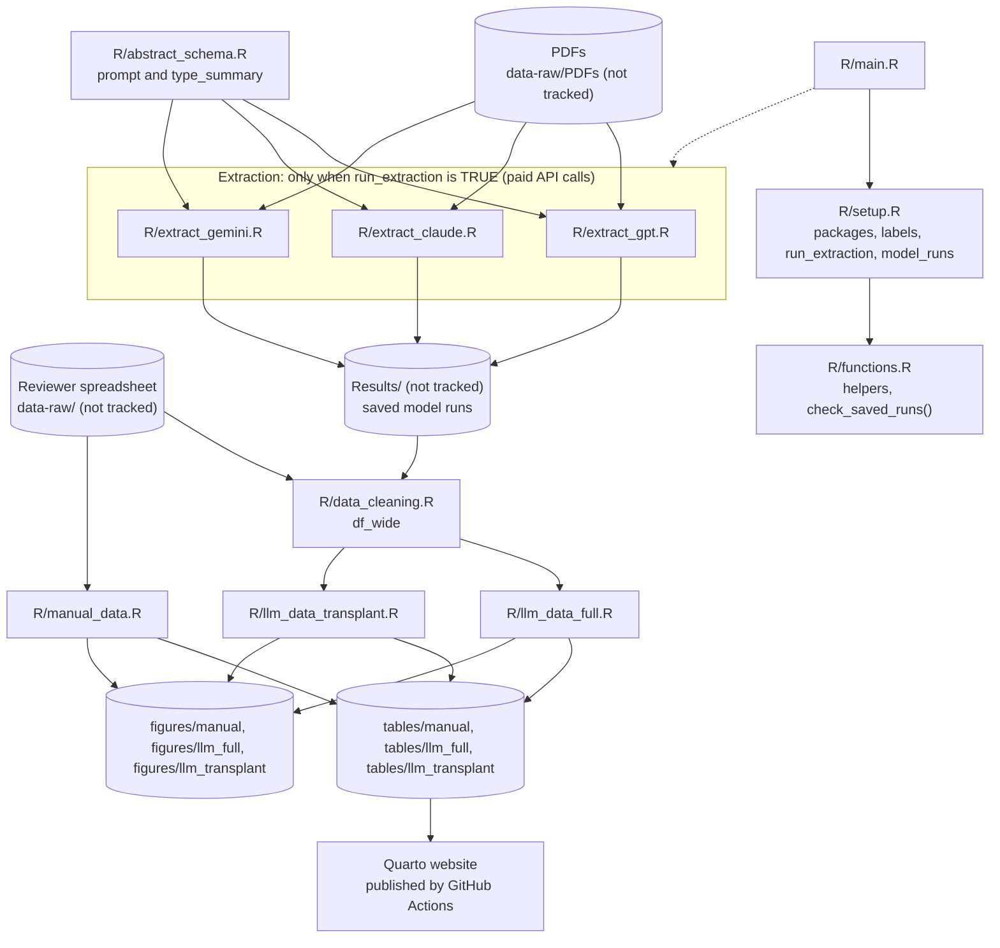

# Architecture

How the analysis is implemented: the scripts, the order they run in, what each needs and produces, and how data flow between them. It describes the repository as restructured for issues [#4](https://github.com/VagishHemmige/USRDS-PDF-analysis-project/issues/4) and [#5](https://github.com/VagishHemmige/USRDS-PDF-analysis-project/issues/5), on top of commit `482fb01` on `master`. Design intent is in [`analysis-plan.md`](https://github.com/VagishHemmige/USRDS-PDF-analysis-project/blob/master/analysis-plan.md); open work is in [GitHub Issues](https://github.com/VagishHemmige/USRDS-PDF-analysis-project/issues).

## Overview

The project evaluates whether large language models (LLMs) can extract study characteristics from published papers that use United States Renal Data System (USRDS) data, compared with manual review by two reviewers. A second strand reports the reporting practices found by manual review, for a letter.

`R/main.R` runs the analysis in dependency order. It never calls a model: it reads the saved model runs listed in `model_runs` (`R/setup.R`), and the extraction scripts, which call paid model APIs, run only when `run_extraction` is set to `TRUE`. The analysis scripts read the saved runs and the reviewer spreadsheet, and save `gt` tables to `tables/<strand>/` and `ggplot2` and `flowchart` figures to `figures/<strand>/`. The Quarto website shows the code without running it and displays the saved tables.

## Data flow

## Components

### Orchestration and setup

**`R/main.R`** sources `R/setup.R` and `R/functions.R`; the three extraction scripts only if `run_extraction` is `TRUE`; then `R/data_cleaning.R`, `R/manual_data.R`, `R/llm_data_full.R` and `R/llm_data_transplant.R`.

**`R/setup.R`** loads the packages the analysis scripts rely on (they do not call `library()` themselves) and defines `label_list` (variable labels for tables), `timing_table` (approximate run time per model), `run_extraction` (`FALSE`) and `model_runs`. `model_runs` has one row per model: its identifier, the text it was sent, the path of its saved output in `Results/`, and a status. The three existing runs are `legacy`: their settings are recorded as the extraction scripts stood when they were made. Labels: `setup-libraries`, `setup-labels`, `setup-timing`, `setup-model-runs`.

**`R/functions.R`** holds the helpers: `convert_to_logical()`, `compute_kappa()` (Cohen's κ through `irr::kappa2()` on complete pairs), `get_breakdown()`, `add_label_for_gt()`, `kappa_fill()`, `create_kappa_legend_gt()`, `make_llm_agreement_heatmap()`, and `check_saved_runs()` and `saved_run_path()`, which check that the runs in `model_runs` exist and return their paths. Labels: `fn-*`.

### Extraction

**`R/abstract_schema.R`** defines the prompt, `id_prompt()`, and the structured output type, `type_summary` (44 fields), shared by the three extraction scripts.

**`R/extract_gpt.R`**, **`R/extract_claude.R`** and **`R/extract_gemini.R`** each stop at once unless `run_extraction` is `TRUE`. When allowed to run, each reads every PDF in `data-raw/PDFs` with `pdftools::pdf_text()`, sends the text with the prompt through `ellmer` (`chat_openai()` with `gpt-5.1`, `chat_anthropic()` with `claude-sonnet-4-5`, `chat_google_gemini()` with `gemini-2.5-flash`) and `chat_structured()`, one call per paper, and saves the replies in `Results/ChatGPT/`, `Results/Claude/` and `Results/Gemini/`. Each loads its own packages, keeps a job-status or processed-files record and partial checkpoints so a run can resume, retries on rate limits, and in an interactive RStudio session offers to delete its saved files and start over. A new run overwrites the saved files at the paths in `model_runs`.

The text sent differs between scripts. The GPT script sends all pages, up to 240,000 characters, and cuts the text by 10% on each rate-limit retry, down to 5,000 characters. The Claude and Gemini scripts send the first 50 pages, up to 240,000 characters. These scripts have no chunk labels; the LLM data extraction page shows their code directly.

### Import and merge

**`R/data_cleaning.R`** checks the saved runs with `check_saved_runs()`, reads each model's output from its `model_runs` path, and reads the "Reviewer 2" sheet of the reviewer spreadsheet. It renames each source's columns with a suffix (`_ChatGPT`, `_claude`, `_gemini`, `_human`), splits the human multi-select answers (languages, files, data components) into one logical column per option, converts Yes/No to logical, and checks which filenames are missing from each source. It then left-joins the three model datasets to the human data by `filename` into `df_wide`, and lists the human variables to compare in `human_vars`. The confirmation column in the sheet is dropped, not used as a filter. Labels: `import-raw-data` through `human-vars`.

### Analyses

**`R/manual_data.R`** reads the reviewer sheet itself, keeps only rows marked as confirmed, builds the paper-flow diagram with `flowchart`, a table of included papers, and three `gtsummary` tables (overall, by transplant relevance, by transplant study type). Tables go to `tables/manual/`, the flow diagram to `figures/manual/`. It does not use the model outputs.

**`R/llm_data_full.R`** (all papers) cross-tabulates each model against the humans for the new-analysis and transplant classifications, restricts to papers the humans coded as new USRDS analyses (`df_filt_full`), computes κ per variable for each model, builds the κ table, its legend and the breakdown table, and draws heatmaps. Tables go to `tables/llm_full/`, heatmaps to `figures/llm_full/`.

**`R/llm_data_transplant.R`** (transplant subset) does the same on papers the humans coded as new USRDS analyses and transplant-related (`df_filt_atc`), and adds a combined poster heatmap. Tables go to `tables/llm_transplant/`, heatmaps to `figures/llm_transplant/`.

### Website

`_quarto.yml` and the pages in `quarto/` form a Quarto website rendered to `docs/` (not tracked) and published to the `gh-pages` branch by `.github/workflows/publish.yml` on every push to `master`; pull requests get a render check. The workflow installs only `knitr`, `rmarkdown`, `gt` and `tibble`: code pages import their script's labelled sections with `knitr::read_chunk()` and show them with `eval: false`, and results pages load `gt` and print the saved tables (`.rds`) from `tables/`. The Project documents pages include this file, `analysis-plan.md`, `AGENTS.md` and `REPOSITORY-BLUEPRINT.md` from the root. Reader comments use the `issue-comments` extension, and `quarto/_pending.lua` marks provisional content.

The methods diagram, `images/llm-extraction-methods.png`, is generated by `images/llm-extraction/draw.py` (Python standard library) and committed; the site does not run Python.

## Running the analysis

From the project root, in a fresh session: `source("R/main.R")`. With the saved runs in `Results/` and the reviewer spreadsheet in `data-raw/`, this makes no API calls and rewrites `tables/` and `figures/`. To re-extract, set `run_extraction <- TRUE` in `R/setup.R` first; this calls the three model APIs for every paper.

## What is and is not tracked

| Path | Contents | Tracked |
|---|---|---|
| `data-raw/` | PDFs and the reviewer spreadsheet | No |
| `Results/` | Saved model runs, job status and checkpoints | No |
| `Archive/` | Superseded material | No |
| `tables/<strand>/` | Saved `gt` tables (`.rds`, `.html`, `.png`) | Yes |
| `figures/<strand>/` | Heatmaps and the paper-flow diagram (`.png`, `.svg`) | Yes |
| `ATC 2026 abstract/Tables.docx` | Hand-edited abstract tables; no script writes it | Yes |
| `Kidney conference abstract/timing_table_atc.png` | A timing table no current script writes | Yes |
| `docs/` | Local render of the website | No |

## Code references

| Component | File | Key symbols |
|---|---|---|
| Orchestration | `R/main.R` | |
| Settings and saved runs | `R/setup.R` | `run_extraction`, `model_runs`, `label_list` |
| Prompt and schema | `R/abstract_schema.R` | `id_prompt()`, `type_summary` |
| Extraction | `R/extract_gpt.R`, `R/extract_claude.R`, `R/extract_gemini.R` | `extract_summary_row()`, `extract_summary_single()` |
| Merge | `R/data_cleaning.R` | `df_wide`, `human_vars` |
| Agreement and runs | `R/functions.R` | `compute_kappa()`, `get_breakdown()`, `kappa_fill()`, `create_kappa_legend_gt()`, `make_llm_agreement_heatmap()`, `check_saved_runs()`, `saved_run_path()` |
| All-papers analysis | `R/llm_data_full.R` | `df_filt_full`, `kappa_results_full` |
| Transplant analysis | `R/llm_data_transplant.R` | `df_filt_atc` |
| Letter | `R/manual_data.R` | `paper_table_gt`, `letter_table1_gt`–`letter_table3_gt` |
| Site | `_quarto.yml`, `quarto/`, `.github/workflows/publish.yml` | |

## Glossary

| Term | Meaning |
|---|---|
| κ | Cohen's kappa, agreement between a model and the human answers beyond chance |
| Kidney conference | The kidney conference abstract (all papers); formerly the NKF analysis |
| ATC | The American Transplant Congress 2026 abstract (transplant-related papers) |
| New analysis | A paper the reviewers coded as a new patient-level analysis of USRDS data |
| Legacy run | A saved model run made before `model_runs` recorded runs; its settings are not verified from the run itself |
