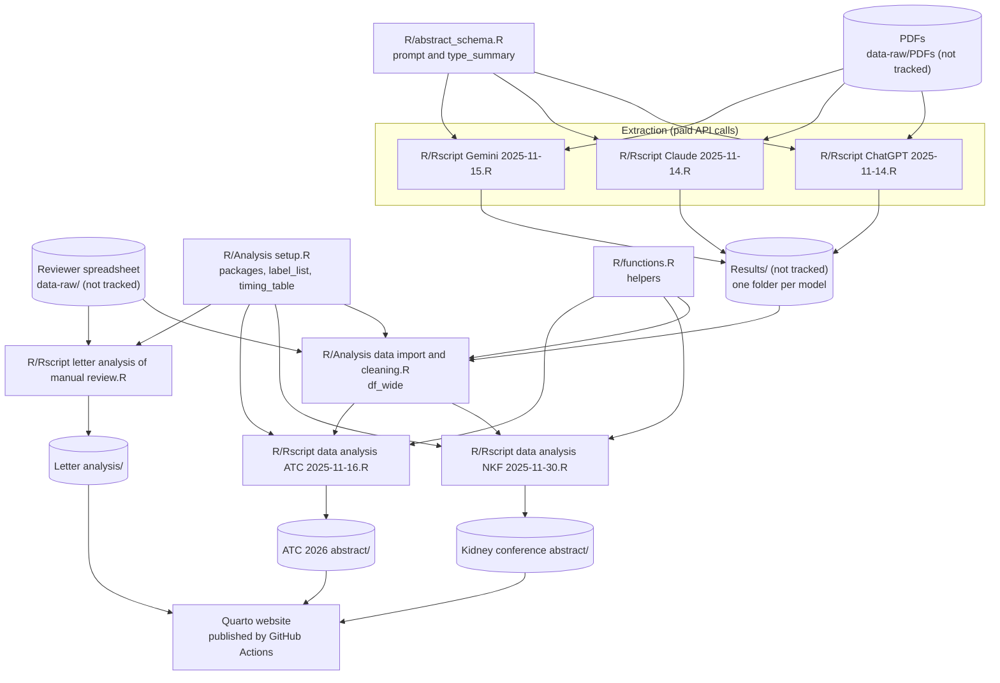

# Architecture

How the analysis is implemented: the scripts, the order they run in, what each needs and produces, and how data flow between them. It describes the repository at commit `35e0ac7` on `master`; uncommitted changes were not included. Design intent is in [`analysis-plan.md`](https://github.com/VagishHemmige/USRDS-PDF-analysis-project/blob/master/analysis-plan.md); open work is in [GitHub Issues](https://github.com/VagishHemmige/USRDS-PDF-analysis-project/issues).

## Overview

The project evaluates whether large language models (LLMs) can extract study characteristics from published papers that use United States Renal Data System (USRDS) data, compared with manual review by two reviewers. A second strand reports the reporting practices found by manual review, for a letter.

There is no `R/main.R`; scripts are run by hand, in the order below, in one R session. The extraction scripts call paid model APIs. The analysis scripts read the saved model outputs and the reviewer spreadsheet, and save `gt` tables and `ggplot2` figures into one folder per product. The Quarto website shows the code without running it and displays the saved tables.

## Data flow

## Components

### Setup and helpers

**`R/Analysis setup.R`** loads the packages every analysis script relies on (none of the analysis scripts call `library()` themselves) and defines `label_list`, which maps variable names to the labels used in tables, and `timing_table`, the approximate run time per model. Labels: `setup-libraries`, `setup-labels`, `setup-timing`.

**`R/functions.R`** holds the helpers the import and analysis scripts use: `convert_to_logical()`, `compute_kappa()` (Cohen's κ through `irr::kappa2()` on complete pairs), `get_breakdown()`, `add_label_for_gt()`, `kappa_fill()`, `create_kappa_legend_gt()` and `make_llm_agreement_heatmap()`. Labels: `fn-*`.

### Extraction

**`R/abstract_schema.R`** defines the prompt, `id_prompt()`, and the structured output type, `type_summary` (44 fields), shared by the three extraction scripts.

**`R/Rscript ChatGPT 2025-11-14.R`**, **`R/Rscript Claude 2025-11-14.R`** and **`R/Rscript Gemini 2025-11-15.R`** each read every PDF in `data-raw/PDFs` with `pdftools::pdf_text()`, send the text with the prompt through `ellmer` (`chat_openai()` with `gpt-5.1`, `chat_anthropic()` with `claude-sonnet-4-5`, `chat_google_gemini()` with `gemini-2.5-flash`) and `chat_structured()`, one call per paper, and save the replies in `Results/ChatGPT/`, `Results/Claude/` and `Results/Gemini/`. Each keeps a job-status or processed-files record and partial checkpoints so a run can resume, and retries on rate limits.

The text sent differs between scripts. The ChatGPT script sends all pages, up to 240,000 characters, and cuts the text by 10% on each rate-limit retry, down to 5,000 characters. The Claude and Gemini scripts send the first 50 pages, up to 240,000 characters. These scripts have no chunk labels; the LLM data extraction page shows their code directly.

### Import and merge

**`R/Analysis data import and cleaning.R`** reads the three models' saved outputs and the "Reviewer 2" sheet of the reviewer spreadsheet. It renames each source's columns with a suffix (`_ChatGPT`, `_claude`, `_gemini`, `_human`), splits the human multi-select answers (languages, files, data components) into one logical column per option, converts Yes/No to logical, and checks which filenames are missing from each source. It then left-joins the three model datasets to the human data by `filename` into `df_wide`, and lists the human variables to compare in `human_vars`. The confirmation column in the sheet is dropped, not used as a filter. Labels: `import-raw-data` through `human-vars`.

### Analyses

**`R/Rscript data analysis NKF 2025-11-30.R`** (all papers) cross-tabulates each model against the humans for the new-analysis and transplant classifications, restricts to papers the humans coded as new USRDS analyses (`df_filt_full`), computes κ per variable for each model, builds the κ table, its legend and the breakdown table, and draws heatmaps. It saves everything to `Kidney conference abstract/`.

**`R/Rscript data analysis ATC 2025-11-16.R`** (transplant subset) does the same on papers the humans coded as new USRDS analyses and transplant-related (`df_filt_atc`), adds a combined poster heatmap, and saves to `ATC 2026 abstract/`.

**`R/Rscript letter analysis of manual review.R`** reads the same reviewer sheet itself, keeps only rows marked as confirmed, builds the paper-flow diagram with `flowchart`, a table of included papers, and three `gtsummary` tables (overall, by transplant relevance, by transplant study type), and saves them to `Letter analysis/`. It does not use the model outputs.

### Website

`_quarto.yml` and the pages in `quarto/` form a Quarto website rendered to `docs/` (not tracked) and published to the `gh-pages` branch by `.github/workflows/publish.yml` on every push to `master`; pull requests get a render check. Code pages import their script's labelled sections with `knitr::read_chunk()` and show them with `eval: false`. Results pages read the saved `gt` tables (`.rds`) from the three product folders and print them. The Project documents pages include this file, `analysis-plan.md`, `AGENTS.md` and `REPOSITORY-BLUEPRINT.md` from the root. Reader comments use the `issue-comments` extension, and `quarto/_pending.lua` marks provisional content.

The methods diagram, `images/llm-extraction-methods.png`, is generated by `images/llm-extraction/draw.py` (Python standard library) and committed; the site does not run Python.

## Running the analysis

In one R session, from the project root:

1. `R/Analysis setup.R`, then `R/functions.R`.
2. Only to re-extract, which costs money: the three extraction scripts.
3. `R/Analysis data import and cleaning.R`.
4. `R/Rscript letter analysis of manual review.R`, `R/Rscript data analysis NKF 2025-11-30.R` and `R/Rscript data analysis ATC 2025-11-16.R`, in any order.

Steps 3 and 4 make no API calls. Issue [#4](https://github.com/VagishHemmige/USRDS-PDF-analysis-project/issues/4) proposes an `R/main.R` for this order.

## What is and is not tracked

| Path | Contents | Tracked |
|---|---|---|
| `data-raw/` | PDFs and the reviewer spreadsheet | No |
| `Results/` | Saved model outputs, job status and checkpoints | No |
| `Archive/` | Superseded material | No |
| `Kidney conference abstract/`, `ATC 2026 abstract/`, `Letter analysis/` | Saved tables (`.rds`, `.html`, `.png`) and figures | Yes |
| `docs/` | Local render of the website | No |

## Code references

| Component | File | Key symbols |
|---|---|---|
| Prompt and schema | `R/abstract_schema.R` | `id_prompt()`, `type_summary` |
| Extraction | `R/Rscript ChatGPT 2025-11-14.R`, `R/Rscript Claude 2025-11-14.R`, `R/Rscript Gemini 2025-11-15.R` | `extract_summary_row()`, `extract_summary_single()` |
| Merge | `R/Analysis data import and cleaning.R` | `df_wide`, `human_vars` |
| Agreement | `R/functions.R` | `compute_kappa()`, `get_breakdown()`, `kappa_fill()`, `create_kappa_legend_gt()`, `make_llm_agreement_heatmap()` |
| All-papers analysis | `R/Rscript data analysis NKF 2025-11-30.R` | `df_filt_full`, `kappa_results_full` |
| Transplant analysis | `R/Rscript data analysis ATC 2025-11-16.R` | `df_filt_atc` |
| Letter | `R/Rscript letter analysis of manual review.R` | `paper_table_gt`, `letter_table1_gt`–`letter_table3_gt` |
| Site | `_quarto.yml`, `quarto/`, `.github/workflows/publish.yml` | |

## Glossary

| Term | Meaning |
|---|---|
| κ | Cohen's kappa, agreement between a model and the human answers beyond chance |
| NKF | The kidney conference abstract (all papers) |
| ATC | The American Transplant Congress 2026 abstract (transplant-related papers) |
| New analysis | A paper the reviewers coded as a new patient-level analysis of USRDS data |
